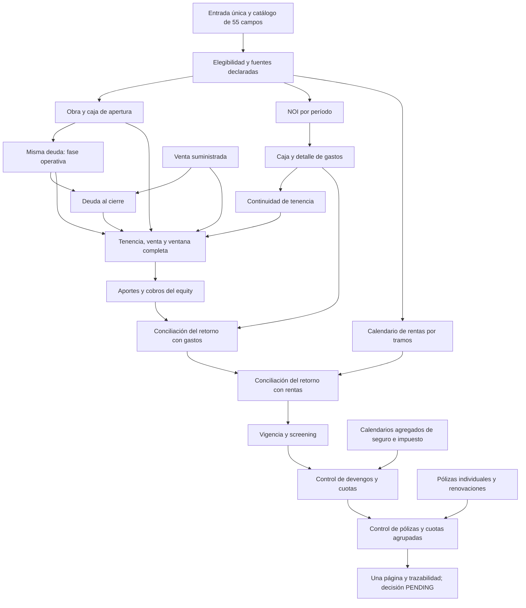

# Mini-UW: dependencias e impacto de cambios D05

El mapa permite revisar qué fuentes alimentan cada cálculo de la ruta sintética T95 y qué resultados deben volver a comprobarse cuando cambia una entrada. Se contrasta con dos expedientes completos existentes: seguro de renovación de 10 y revisión a 12. Conserva el diseño y los pendientes de [D04](MiniUW_Estructura_Vigente_D04.md).

La evidencia incluye 61 nodos: 35 grupos de fuentes y 26 cálculos o controles. Cada fuente tiene localizador dentro del JSON recibido; cada productor tiene archivo, función, línea y SHA-256. Se reproducen ambos expedientes y sus páginas para comparar las huellas efectivamente obtenidas. La verificación registra 18 productores con huellas distintas y ocho con huellas idénticas en este ejemplo.

El grafo es una declaración conservadora para este perfil, revisada contra su código y esta comparación. La prueba de dos casos no demuestra todas las dependencias posibles ni la validez financiera de las fórmulas. El motor sigue reproduciendo la cadena completa. D05 no permite reutilizar un resultado por encontrar una rama aparentemente estable.

## Cómo leer el flujo



La secuencia de ejecución y las dependencias de datos son conceptos distintos. Por ejemplo, el ejecutor procesa el calendario de renta después del detalle de gastos, pero la fuente de renta es independiente. Su resultado se compara con el ingreso residencial suministrado al NOI en la conciliación posterior. Este perfil no genera automáticamente el NOI desde el calendario ni convierte NOI en distribución al inversor.

## Entradas, salidas y bloqueos por tramo

Los identificadores siguientes coinciden con el [CSV completo](MiniUW_Dependencias_D05.csv). Las rutas `/recipe/...` pertenecen al expediente base, extraído sucesivamente de `/scheduled_case_utf8` y `/base_case_utf8` del expediente T94. Los calendarios y registros exteriores tienen sus propios localizadores en el [JSON verificable](MiniUW_Dependencias_D05.json).

| Tramo e identificador | Entradas principales | Salida y uso posterior | Bloqueo que debe conservarse |
| --- | --- | --- | --- |
| Obra: `construction_cash` | `/recipe/construction_loans`, `preopening_source`, `construction_binding` | Desembolsos, principal y caja; base de la transición operativa y ventana total | Fuente incompleta, principal/caja incompatibles o financiación no conciliada |
| Transición: `operating_phase` | Obra y `/recipe/phase_contract` | Calendario operativo de la misma obligación; deuda para venta | Cambio de obligación o términos no soportados; no crear un refinanciamiento implícito |
| NOI por período: `NOI:*` | `/recipe/operating_periods/i/noi_source` | Ingreso menos gastos expresos; insumo de caja y tenencia | Datos, unidades, contexto o perfil incompletos; no aplicar coeficientes fiscales por defecto |
| Caja: `operating_cash:*` | NOI y `cash_source` del mismo período | Pagos, saldos y distribución propuesta conciliada | Diferencia de caja, pago o saldos; un reparto suministrado no acredita derecho a distribuir |
| Gastos: `expense_detail:*` | NOI, caja y `expense_detail` por concepto | Puente devengo–pago–saldo; control del retorno | Compensaciones entre conceptos, discontinuidad o inventario incompleto |
| Rentas: `phased_rental:*` | `rental_calendar`, disponibilidad y fracciones expresas | Renta efectiva por tramos; control del ingreso residencial | Mes/tramo/grupo faltante, identidad física incompatible o fracción ausente; no interpolar |
| Tenencia: `holding_cash` | Todos los NOI/cajas y `/recipe/holding_manifest` | Cadena de saldos y repartos | Apertura distinta del cierre anterior o período faltante |
| Venta: `sale_cash`, `sale_debt` | `/recipe/sale`, deuda operativa y cierre calculado | Residual de venta y conciliación de principal/interés | Saldo, fecha o calendario incompatibles; no contar dos veces principal o balloon |
| Ventana: `hold_sale`, `staged_operating_window` | Tenencia, venta, deuda, obra y bindings de frontera/ventana | Continuidad desde obra hasta venta | Doble aporte inicial, salto de caja o vínculo incompatible |
| Retorno: `lifecycle_return` | Ventana y `/recipe/investor_source`, `investor_binding` | Aportes/cobros brutos, resultado de caja, EM e intervalos de TIR | Movimiento sin vínculo o fuente; no reparar el ledger para obtener un resultado favorable |
| Controles del retorno: `expense_checked_return`, `phased_rental_return` | Retorno, detalles de gastos/calendarios y manifiestos | Retorno sólo después de conciliar todos los períodos y conceptos | Diferencia renta–NOI o gastos–caja aunque el ledger agregado cuadre |
| Vigencia: `source_currency` | Retorno, registro base e instante UTC expreso | Vista actual o retirada de la vista actual | Fuente vencida, sustituida, estimada, pendiente o incompatible; historia conservada |
| Métricas: `screening` | Proyección, diez criterios y contexto | Comparación sintética con pendientes explícitos | Falta de métrica/regla, banda o conflicto: PENDING; no adoptar umbrales históricos |
| Seguro/impuesto: `schedule:*`, `scheduled_current` | Calendarios agregados T90, binding de cuotas, registro propio y expediente base exacto | Devengos/cuotas conciliados con los conceptos y pagos existentes | Ventana/inventario/fracción/fecha/importe incompatible; no generar otro gasto o pago |
| Renovaciones: `policy:*`, `policy_current` | Pólizas T93, agregado correspondiente, registro propio y expediente padre exacto | Costos y cuotas de pólizas conciliados; vista actual completa | Gap/solapamiento, cuota sin grupo, diferencia de grupo o vigencia pendiente |
| Salida: `report` | Expediente exacto, resultado T94 reproducido y screening | PDF de una página y trazabilidad del resultado | No publicar una proyección actual parcial si falla una puerta del recorrido |

La tabla es una guía de revisión. El grafo contiene agrupaciones deliberadamente amplias, como toda la sección de venta o los instantes de vigencia, por lo que puede marcar para revisión más nodos que los cuyos importes cambian. No sustituye los bloqueos completos de cada contrato/productor.

## Qué ocurre al cambiar una prima de 10 a 12

Se usan sin editar [el expediente base de pólizas](../../templates/miniuw-v1-policy-renewal-case.json) y [la revisión completa de renovación](../../templates/miniuw-v1-policy-renewal-twelve-case.json). La revisión ya contiene sus propios cambios coherentes de NOI, gastos, pagos, caja y evidencia. El sistema no propaga automáticamente la cifra 12 a las demás fuentes para hacerlas cuadrar.

| Resultado condicional, USD sintéticos | Base | Revisión suministrada |
| --- | ---: | ---: |
| Aportes brutos del equity total del proyecto | 1.400 | 1.400 |
| Cobros operativos propuestos | 200 | 200 |
| Cobro neto de venta | 578 | 576 |
| Cobros totales | 778 | 776 |
| Resultado neto de caja | −622 | −624 |
| Equity multiple exacto | 389/700 | 97/175 |
| Decisión operacional | PENDING | PENDING |

Estas cifras se conservan en `cases/i/observed_return_summary` del JSON y proceden de `/current_project_return_story` de cada corrida reproducida. Pertenecen al equity agregado. No describen el retorno personal de un inversor ni acreditan que el precio de venta o los repartos sean realizables.

La revisión modifica los productores de NOI/caja/detalle del segundo período, tenencia, cierre/deuda de venta, ventana, retorno, conciliaciones, vigencia, calendario de seguro, pólizas, screening y reporte: 18 huellas distintas. El calendario de impuesto, los cuatro productores del primer período —NOI, caja, detalle y renta—, la renta del segundo período, la obra y su transición de deuda conservan sus ocho huellas.

El importe de la deuda puede permanecer igual mientras cambia la huella de su conciliación por una nueva fuente de cierre. Por eso una huella distinta significa evidencia/resultado reproducido distinto, y no necesariamente una variación de todos sus importes. El JSON diferencia `data_dependency_affected_nodes`, alcance conservador de revisión, y `observed_changed_producers`, cambios efectivamente observados.

## Vigencia, versiones y límites del mapa

La entrada de cada rama se conserva con los bytes exactos o con su subárbol JSON canónico, según se indique. Las selecciones de catálogo, identidad e instantes incluyen todos los punteros necesarios para volver a extraer sus valores. Cambiar la representación de un expediente puede invalidar su binding de bytes aunque su dinero sea idéntico. Cambiar contexto, revisión, criterios o vigencia también exige revisar los controles, sin afirmar que cambió la economía.

`producer_dependency_fingerprints` es una huella estructural local para esta demostración: combina identificador, versión del productor, fuente y dependencias. Es distinta de la huella emitida por el productor. No es una autorización de caché, una prueba bancaria ni una prueba de autenticidad de una fuente.

El control fija 24 archivos de productor/orquestación/verificación y resuelve sus funciones mediante AST. Para localizar un cálculo, consultar `nodes/i/source_function`; para una entrada, `nodes/i/source_location`; para las diferencias lógicas de fuentes, `demonstration/logical_input_changes`. La extracción comprueba que cada localizador reproduce su valor declarado. La comparación de huellas comprueba que ningún productor observado como cambiado queda fuera del alcance de revisión declarado.

## Evidencia y pendientes

| Requisito de esta ampliación | Evidencia verificable | Estado y pendiente |
| --- | --- | --- |
| Localizar entradas y cálculos del perfil actual | JSON/CSV D05, localizadores resueltos, SHA y funciones con línea | Comprobado estructuralmente para los dos expedientes suministrados; ampliar mapa si cambia el perfil |
| Seguir el impacto de una revisión | Dos corridas y dos PDFs reproducidos; 18 huellas distintas alcanzadas | Comprobado en este caso; no prueba universal de independencia |
| Rechazar un mapa alterado | Siete defectos deliberados: nodo ausente, ciclo, dependencia omitida, localizador de función/entrada falso, cierre financiero indebido y huella observada falsificada | El registro D05 enumera los rechazos; son controles estructurales separados de los ocho casos I01 |
| Conservar los 55 campos y requisitos originales | [Cruce D04](MiniUW_55_campos_D04.csv), [matriz histórica de 398 filas](../coverage-matrix.csv) | Una vinculación sintética acotada; 54 mapeos semánticos runtime pendientes. D05 no los declara cubiertos |
| Entregar retorno personal y capital/CoC | Bloqueos y valores nulos conservados en el resumen de cada corrida | Pendiente de términos y definiciones aplicables; no deducir del equity agregado |
| Aceptación financiera de todos los módulos | Puertas originales y D04 conservados | Pendiente; pruebas técnicas no certifican el modelo financiero completo |

La ruta con refinanciación intermedia existe por separado; D05 describe obra → misma deuda operativa → tenencia → venta. No integra de forma implícita ambas rutas. Se mantienen pendientes el adaptador real completo de Lorena, las reglas aplicables, el mapa financiero completo de los 55 campos, ocho métricas sin punto calculado, los datos de capital/equity/CoC, la asignación personal y la validación financiera independiente. La TIR conserva todos los intervalos calculados sin seleccionar un punto.

El requisito de una página corresponde a la salida externa de un deal. Este documento y su CSV son documentación interna de estructura. No se habilitan decisiones reales, bots externos, publicación financiera o despliegue. El registro total de pruebas técnicas permanece en 1.351; D05 agrega un control estructural de lectura y reproducción a CI.

## Reproducir la verificación

Desde la raíz del repositorio, con las dependencias ya instaladas según `requirements-reference.txt`:

```bash
PYTHONDONTWRITEBYTECODE=1 python tools/check_dependency_structure_D05.py
```

El comando lee las fuentes, reproduce los dos casos y sus reportes en memoria, valida JSON/CSV y rechaza los siete defectos. No escribe archivos ni llama servicios. El resultado debe coincidir con [D05-structural-validation.json](D05-structural-validation.json). `--emit-snapshot` y `--emit-record` sólo imprimen sus candidatos a stdout para preparar una revisión explícita.
