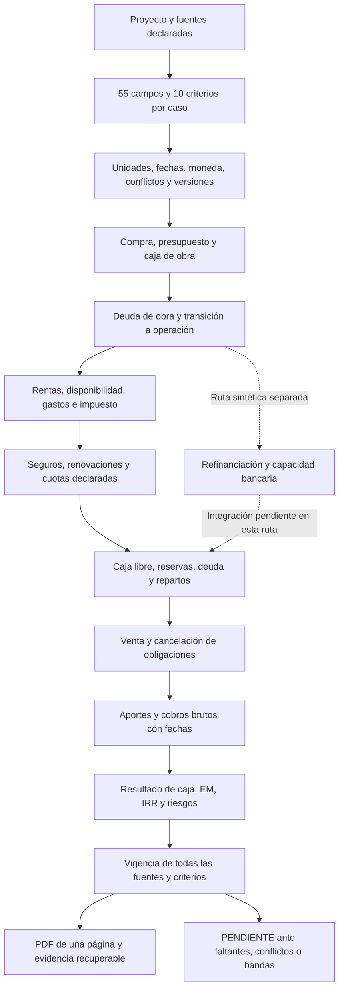

# Estructura vigente del Mini-UW

El Mini-UW recibe un expediente con métricas y fuentes declaradas, reconstruye costos, deuda y caja, calcula el retorno agregado del proyecto y prepara una página con resultados y bloqueos. La estructura actual permite pruebas sintéticas; las definiciones financieras, la adaptación completa de la hoja real y la aprobación de inversión conservan sus pendientes.

## Flujo integrado

La ruta T95 integra obra → misma deuda operativa → alquiler → gastos/seguros → venta, con todos sus controles de fuente. La refinanciación intermedia tiene productores anteriores separados; su conexión a esta ruta completa sigue pendiente. El gráfico expresa dependencias de información; los gastos y pagos se descuentan una sola vez en su caja correspondiente.

## Bloques y estado

| Bloque | Entrada y salida | Estado actual y pendiente |
|---|---|---|
| Recepción y programa | Fuentes y hoja → inventario, valores y discrepancias | Lectores sintéticos CSV/XLSX y catálogo55; semántica financiera completa/hoja real pendientes |
| Planos y datos oficiales | Originales → lecturas/citas conciliadas | Contratos de roles; lectores y verificación oficial pendientes |
| Presupuesto y calendario | Usos, fechas y fuentes → caja previa a operación | Perfiles de caja sintética; activos/devengos/TDC completo pendientes |
| Deuda de obra y apertura | Draws, términos y fechas → saldos e interés/carry operativo | Perfil de misma obligación conectado; contratos auténticos/novación/refi nuevos pendientes |
| Renta y operación | Capacidad, disponibilidad, renta/base, pérdidas y concesiones → ingreso/NOI | Tramos y fracciones suministrados conectados; absorción, contratos, cobranza y autoridad pendientes |
| Gastos e impuesto | Conceptos/devengos/pagos/saldos → conciliación por período | T76/T91; impuesto condicional y fechas suministradas, sin ley/vencimiento real acreditado |
| Seguros y renovaciones | Primas/fracciones/pólizas/cuotas → mismos gastos/pagos conciliados | T90–T95; sucesión temporal y cuotas agrupadas, sin suficiencia de cobertura acreditada |
| Tenencia y venta | Caja, deuda, reservas, costos y proceeds → cobros/aportes de equity | Ruta completa sintética; valores/proceeds/costos son hipótesis suministradas |
| Retorno del inversor | Flujos brutos/fechas/base → resultado, EM e intervalos IRR | Equity agregado; capital/equity/CoC/retorno personal pendientes de sus bases |
| Criterios y decisión | Métricas comparables y criterios nuevos → comparaciones y bloqueos | Diez posiciones; sólo EM puntual derivado en esta ruta, sin decisión real |
| Evidencia e informe | Fuentes/versiones/UTC → una página y registros internos | Reproducción, hashes y retiro de cifras vencidas; autenticación/auditoría financiera pendientes |

## Variables originales y datos complementarios

La [matriz de los 55 campos](MiniUW_55_campos_D04.csv) conserva etiqueta, unidad literal, documento, SHA256, ubicación exacta, definición provisional, consumidor propuesto, observación runtime y pendientes de cada variable. El [registro completo](MiniUW_Estructura_Vigente_D04.json) incluye también las diez métricas y fuentes de esta consolidación. El original permanece vacío: el ejemplo actual vincula1/55 campos y deja54 pendientes. Un consumidor propuesto o una variable mencionada no equivalen a conexión financiera validada.

Los 55 campos no bastan para afirmar que el expediente está listo. Los perfiles ejecutados requieren además contexto/moneda/fechas, fuentes por concepto, usos y términos de deuda, calendarios completos, pagos/saldos, cobros/aportes separados, base del retorno, criterios y registro de evidencia. Los requisitos históricos REQUIRED/IF APPLIES/OPTIONAL se conservan; no se inventa una regla automática de aplicabilidad, un rango o una moneda a partir del símbolo `$`.

| Grupo complementario | Variables simplificadas que necesita la corrida |
|---|---|
| Identificación y evidencia | Caso, revisión, escenario, definición, moneda, UTC, fuente/hash/localizador/estado/fechas |
| Compra y obra | Equity, usos, fechas, draws, interés/comisiones, principal y saldos al abrir operación |
| Renta | Unidades/áreas/base, capacidad/disponibilidad, períodos, renta, pérdidas, concesiones y fracciones suministradas |
| Gastos | Devengo, pagos, por pagar/prepagado inicial/final, impuesto condicional y clasificación |
| Seguro | Costo total, pólizas y cobertura temporal, primas, asignaciones, cuotas, grupos y mapa a pagos |
| Deuda y caja | Términos operativos, fechas/principal/interés/fees, caja libre/restringida, reservas, capex y repartos |
| Venta | Fecha, proceeds, deuda/obligaciones, costos, caja retenida y cobro neto |
| Retorno | Aportes/cobros brutos y fechas, ventana, base por10, capital/equity/CoC y condiciones personales si se pretende retorno individual |
| Evaluación | Diez métricas, definiciones/unidades/períodos, criterios por escenario y fuentes aplicables |

## Qué responde el retorno

La página debe explicar cuánto se aporta, cuánto se cobra y cuándo, cobro de refi/cash-in cuando corresponda, venta, resultado de caja, EM, IRR y riesgos. Los ejemplos muestran equity del proyecto; una referencia por10 requiere base explícita y conserva el calendario de aportes adicionales. No representa automáticamente una inversión personal ni transforma equity retenido en efectivo cobrado.

En el ejemplo de primas10/10, aportes1.400 y cobros778 producen resultado de caja−622. Una renovación suministrada12, con todas las fuentes compatibles, deja cobros776 y resultado−624. El cambio de costo2 se cuenta una vez. Son hipótesis sintéticas de prueba; no acreditan una prima de mercado, rentabilidad personal o decisión de inversión.

## Métricas y pendientes

| Métrica | Estado en la ruta actual |
|---|---|
| YoC | NOI estabilizado y TDC all-in compatibles pendientes |
| Spread | YoC y cap de referencia compatibles pendientes |
| Equity recuperado | Base de equity y alcance de refinanciación pendientes |
| Equity cash-in | Base y alcance de refinanciación pendientes |
| Ocupación de equilibrio | Función de ingreso/costos/impuesto/deuda pendiente |
| CoC pos-refi | Base de capital remanente y estrategia pendientes |
| Equity/TDC | Definición y conciliación de equity/TDC pendientes |
| EM | Calculado desde aportes/cobros brutos; criterio del deal pendiente |
| IRR/TIR | Todas las raíces e intervalos anuales conservados; ningún punto elegido para el comparador |
| Asking/precio soportado | Definición de RLV/objetivos y alcance de precio pendientes |

Los criterios empiezan vacíos por caso. Los umbrales históricos no se activan por defecto. Los casos Base/Downside exigen sus propios datos y reglas; no se copia un escenario ni se escoge el caso más favorable. Un valor matemático compatible no acredita una regla financiera adoptada.

## Estados y reglas del modelo

- Estructura inválida o perfil no admitido: rechazo explícito y salida final incompleta no publicada.
- Datos/reglas/fuentes pendientes, conflictos o bandas: decisión PENDIENTE; las cifras actuales afectadas se retiran.
- Matemática sintética compatible y evidencia declarada actual: proyección condicionada visible; decisión real y aprobación financiera siguen pendientes.
- Cero explícito conserva su valor; ausencia o undefined no se reemplazan por cero.
- Fuentes, unidades, monedas, períodos, definiciones y versiones deben concordar; cambios requieren nueva evidencia compatible.
- Equity, deuda, reservas, valor retenido y cobros no se mezclan; cada flujo se cuenta una vez.
- No se inventan áreas, precios, reglas fiscales/contables, primas, shocks, financiación o reparto personal.
- Una revisión profesional propuesta no ajusta variables automáticamente para conseguir PASS; conserva el original y los cambios.
- El informe financiero externo objetivo es una página; evidencia y trazabilidad internas pueden ser extensas.
- PASS por sí solo no autoriza inversión o Full UW. Autenticación, revisión aplicable y publicación productiva siguen pendientes.

## Dots y bots

Los [contratos funcionales](../MiniUW_v1_Dots_y_Bots.md) definen siete Dots y17 roles de bot. Recepción/validación, cálculo, comparación e informe tienen partes sintéticas ejecutables. Planos, búsqueda/verificación oficial y auditoría financiera independiente siguen pendientes. La estructura de roles no implica agentes desplegados.

## Próximas conexiones

La continuidad del armado debe concentrarse en conectar la semántica de la hoja completa, variantes temporales completas y obligaciones fuera de ventana, refinanciación/novación con obra y operación, y bases de capital/CoC/retorno personal. Cada extensión conserva fuentes y bloqueos y necesita su propio alcance y validación. Las reglas o datos no acreditados permanecen pendientes de Lorena, banco/GC o revisión aplicable; la preparación técnica continúa con datos sintéticos.

Esta consolidación estructural no calcula un porcentaje de avance ni certifica cierre financiero por contar documentos o pruebas. El registro histórico I01 y la matriz398 permanecen preservados. Sin despliegue ni decisiones reales.
