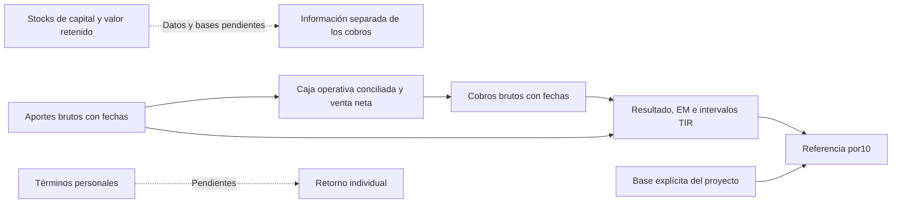

# Mini-UW: salida para el inversor D07 y página T96

La salida debe explicar cuánto se aporta, cuánto se cobra y cuándo, qué capital permanece invertido y cuáles son el retorno y sus riesgos. D07 convierte esas preguntas en un contrato de 23 campos, con definición, fuente exacta, selector, estado y evidencia de presentación. Los campos pendientes no se declaran cubiertos por aparecer en la lista.

T96 incorpora una mejora concreta a la página: aportes, cobros y caja neta por año, además de los cobros operativos/CoC existentes. Agrega punteros de moneda, alcance y ventana de caja. Usa los resultados ya calculados; no cambia la economía ni introduce políticas. [PDF sintético T96](../review/miniuw-v1-investor-output-example/MiniUW_v1_Resumen.pdf) y [alcance técnico](../technical-implementation-T96.md).

El [CSV de 23 campos](MiniUW_Salida_Inversor_D07.csv) permite revisar requisito → definición → ubicación runtime → valor/pendiente → evidencia PDF. El [JSON completo](MiniUW_Salida_Inversor_D07.json) conserva tres corridas, hashes, funciones/líneas y las frases exactas del manifiesto. Las preguntas proceden de `information-flow-summary-FLOW02.json`, `/investor_return_questions/0` a `/8` y `/steps/7/description`; FLOW02 es el requisito de diseño preservado, no prueba de que su alcance esté implementado.

## Qué responde hoy el caso sintético

Los siguientes importes pertenecen al equity agregado del proyecto bajo fuentes hipotéticas. No representan una participación personal, un precio realizable o una recomendación de inversión.

| Pregunta | Caso base, USD sintéticos | Revisión de renovación12 | Estado |
| --- | --- | --- | --- |
| ¿Cuánto aporto y cuándo? | 1.000 el 2026-10-01 y 400 el 2026-11-01; adicionales posteriores explícitos en cero | Igual | Calculado desde la caja vinculada; tres eventos de aporte cero conservados |
| ¿Qué cobro en operación? | 100 el 2027-03-01 y 100 el 2027-06-01 | Igual | Repartos propuestos conciliados; no equivalen a NOI |
| ¿Cuánto cobro en refi y cuánto cash-in requiere? | Ambos cero en esta ruta sin refinanciación intermedia | Igual | No se inventa un mes de refi; la ruta con refi permanece separada |
| ¿Qué cobro al vender? | 578 el 2027-07-01 | 576 el 2027-07-01 | Residual neto, separado del precio bruto |
| ¿Cuánto cobro en total? | 778 | 776 | Operación + venta; sin sumar valor retenido |
| ¿Cuál es el resultado de caja? | −622 | −624 | Cobros menos aportes dentro de la ventana |
| ¿Cuál es el EM? | 389/700 | 97/175 | Cociente exacto de cobros/aportes brutos; no tasa anual |
| ¿Cuál es la TIR anual? | Raíces e intervalos exactos conservados; sin punto elegido | Recalculados con el nuevo cobro | El PDF presenta límites ampliados; el comparador conserva el punto pendiente |
| ¿Cuánto capital sigue invertido? | Pendiente | Pendiente | Falta stock con base/fecha/fuente; no se sustituye por622 o624 |
| ¿Cuánto vale el equity retenido? | Pendiente | Pendiente | Valor separado de caja; no se suma a los cobros |
| ¿Qué CoC anual tengo? | Pendiente | Pendiente | Falta una base anual positiva aplicable |
| ¿Cuál es mi retorno personal? | Pendiente | Pendiente | Faltan términos de reparto y alcance individual; no se aplica proporcionalidad automática |

La renovación12 es una revisión completa suministrada, con gastos, pagos, caja y evidencia compatibles. La variación de costo2 se cuenta una vez. No se ajustan las demás fuentes automáticamente para producir este resultado.

## Caja anual que ahora llega a la página

| Año dentro de la ventana suministrada | Aportes | Cobros totales | Caja neta | Cobros operativos solamente | CoC |
| --- | ---: | ---: | ---: | ---: | --- |
| 2026 | 1.400 | 0 | −1.400 | 0 | Pendiente |
| 2027, caso base | 0 | 778 | +778 | 200 | Pendiente |
| 2027, revisión renovación12 | 0 | 776 | +776 | 200 | Pendiente |

Las dos filas de2027 son alternativas; no se suman entre sí. En el PDF, A significa aporte, C cobro, N neto y O cobro operativo. El cobro total de2027 incluye venta; el numerador de CoC sólo toma operación. Un numerador cero con base ausente no justifica presentar CoC cero.

Las filas cubren la ventana de caja 2026-10-01 a2027-07-01 y conservan sus años calendario. No acreditan un año operativo completo ni anualizan los cobros parciales. Ese indicador permanece en falso en el resultado y en la verificación D07.

## Cómo leer la referencia por10

La base declarada es el total de aportes brutos del proyecto:1.400. La referencia10 escala todos sus movimientos por1/140. En el caso base, los aportes escalados son50/7 y20/7, cuya suma es10; los cobros totales son389/70 y el resultado−311/70. En la revisión, los cobros son194/35 y el resultado−156/35.

Esto responde una comparación del proyecto con base explícita y calendario de aportes. No significa que un inversor personal entregue10 al inicio y cobre automáticamente esas cantidades: los aportes originales ocurren en fechas distintas y los términos individuales siguen pendientes. La página muestra referencia/base/totales; el calendario normalizado completo se conserva en la evidencia interna.



## Contrato y trazabilidad para los bots

| Familia del contrato | Campos | Fuente dentro de `current_project_return_story` | Regla de salida |
| --- | --- | --- | --- |
| Contexto | R01–R03 | `currency`, `equity_level`, `cash_horizon` | Moneda, alcance y ventana con punteros explícitos en la nueva página |
| Flujos por concepto/fecha | R04–R09 | `dated_events`, selector de categoría, y `cash_by_category` | Conservar bruto, fuente, fecha y ceros; cero refi sólo en el perfil suministrado |
| Totales y múltiplo | R10–R13 | `gross_contributions`, `gross_distributions`, `net_cash_profit`, `equity_multiple` | Cocientes/identidades exactos antes de redondear |
| TIR | R14 | `annual_irr_roots`, `selected_IRR`, `periodic_irr/selected_rate` | Todas las raíces/intervalos; nunca inventar el punto comparado |
| Referencia | R15 | `normalized_story` | Base explícita; no reparto LP/JV |
| Stocks | R16–R17 | `capital_snapshots` | Ausencia permanece pendiente; no capitalizar el déficit de caja |
| Caja anual y CoC | R18–R19 | `annual_cash_receipts` | Aportes/cobros/neto por año de la ventana; CoC separado y condicionado |
| Retorno personal | R20 | `personal_investor_return` | Nulo sin términos aplicables; no promesa individual |
| Riesgos de caja | R21–R23 | `risk_observations` | Aportes no recuperados, pico al cierre y dependencia de venta; no pérdida económica final ni liquidez intradía acreditada |

B13 produce los resultados del perfil; B12 conserva las puertas de cálculo/decisión; B15 presenta sólo el resultado reproducido; B16 verifica fuente, resultado y PDF. Son responsabilidades de los [contratos existentes](../MiniUW_v1_Dots_y_Bots.md), no agentes nuevos o desplegados.

Las frases de manifiesto constituyen evidencia de presentación, no aceptación financiera. Una coincidencia de punteros no implica que se imprimió todo un objeto: por ejemplo, la normalización tiene calendario interno completo y resumen por10 en la página. Los pendientes de capital/retorno personal se explican en texto; no tienen cifras que certificar.

## Evidencia comprobada y pendientes

Se reproducen dos expedientes completos actuales y un tercero con evidencia de póliza vencida, definido por la operación D06-04. Se validan23 campos por caso y tres PDFs de una página. Para cada corrida actual se comprueban21 consistencias de flujos brutos, categorías, años, normalización, ceros, TIR no seleccionada y riesgo de déficit al corte. Son consistencias técnicas sobre hipótesis suministradas, no valores financieros esperados de un auditor independiente.

En el caso vencido, los23 valores actuales del contrato se retiran. Se verifican también seis intentos de alterar la evidencia: retorno personal inventado, déficit presentado como capital, año operativo completo indebidamente certificado, caja expuesta pese al bloqueo, campo ausente y habilitación de decisión real. El [registro D07](D07-structural-validation.json) conserva estos controles y21 hashes de fuente/artefacto, con los cuatro archivos del ejemplo comparados contra reproducción completa.

T96 tiene cuatro pruebas unitarias nuevas; el registro técnico total es1.355. D07 no añade pruebas unitarias ni certifica avance financiero por contar campos o verificaciones. D04/D05/D06, los16 originales, la matriz398, criterios vacíos y todos los cálculos/ejemplos anteriores permanecen preservados.

La nueva API es `render_investor_onepage(raw, run)`. El [ejemplo T96](../review/miniuw-v1-investor-output-example/report-manifest.json) identifica código, definición, caso, resultado y renderer padre. Su [comprobación](../review/miniuw-v1-investor-output-example/audit.json) acredita página y frases; el [resultado financiero sin cambios](../review/miniuw-v1-investor-output-example/results.json) conserva la evidencia interna que cita el PDF. El CLI/paquete de ocho artefactos T95 sigue usando su renderer anterior; integrar la presentación nueva en ese transportador y su recuperación portable es trabajo técnico pendiente, sin requerir adoptar reglas financieras.

Continúan pendientes los54 mapeos semánticos runtime de la hoja original, los datos reales, capital/valor retenido/CoC y términos personales, ocho métricas sin punto calculado, reglas aplicables y aceptación financiera. La refinanciación intermedia conserva su ruta separada; la ampliación a Full UW sigue diferida. No hay despliegue, publicación financiera ni decisiones reales.

## Reproducir la comprobación

Con las dependencias de `requirements-reference.txt` ya instaladas, desde la raíz del repositorio:

```bash
PYTHONDONTWRITEBYTECODE=1 python tools/check_investor_output_D07.py
```

El control es de lectura: reproduce los tres casos/reportes en memoria y compara JSON/CSV/registro. `--emit-snapshot` y `--emit-record` sólo imprimen candidatos a stdout para preparar una revisión explícita.
