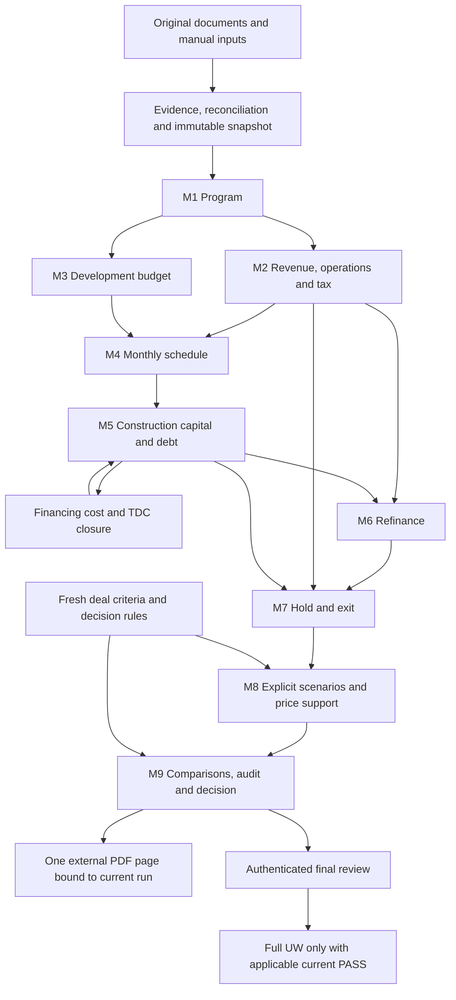

# Initial model contracts and dependency map — draft

Source anchors: D1 pp. 1–4; Master v5.1 §3; Standards policies 9–17; Manual physical pp. 7–14, 50–53; current handoff §§3–7. This specifies responsibilities and unresolved contracts; it is not an implementation or approved house model.

## Module responsibilities

| Module | Inputs / responsibility | Outputs and principal blockers |
|---|---|---|
| M1 Project/program | Explicit plans, unit schedules, source cells, documented units/areas/use/county | Reconciled quantities and provenance. Missing original plans or conflicting program blocks dependents. |
| M2 Revenue/operations/taxes | M1, rents and basis, costs, tax/official evidence, periods | Revenue, expenses, property tax and NOI by period. Tax rules, variable expense definitions and commercial/affordable applicability must be explicit. |
| M3 Development budget | M1, GC scope, land and closing costs, hard/parking/site/soft/contingency/fees | Cost components without double count. C35 inclusions, funded reserves and exclusions unresolved. |
| M4 Monthly schedule | M2/M3, construction/lease-up/TCO, rate/day-count/cash timing conventions | Dated/monthly uses and operating cash. Calendar and draw contracts unresolved. |
| M5 Capital/debt | M4, construction LTC and terms, equity contributions, interest/payoff/reserves | Construction rollforward, capital required, financing cost and TDC. Iterative financing/TDC cycle must close; committed/available capital differs from required capital. |
| M6 Refinance | M2/M5, value, permanent LTV/DSCR/rate/amortization/maturity, costs and reserves | Sizing constraints, payoff, gross investor distribution or required cash-in, restricted reserves and retained equity. Debt proceeds are not automatically investor distributions. |
| M7 Hold/exit | M2/M5/M6, hold dates, growth, debt schedule, exit value/selling costs | Period contributions/distributions, remaining debt, sale net proceeds and investor returns. Balloon at maturity distinguished from amortization. |
| M8 Scenarios/support | Explicit scenario inputs, applicability/deltas/aggregation, M1–M7 and price objectives/domain | Independent results per configured scenario, sensitivities, supported-price findings with feasibility/attainment status. No undocumented shocks or root choice. |
| M9 Decision/audit/page | Complete current scenario results, explicitly entered deal criteria, comparison rules, authentic review | Comparison record, pending/decision state, exactly one external PDF page bound to run/revision; unresolved dependencies prohibit complete decision. |

M8 orchestrates re-execution of affected M1–M7 dependencies; the arrow from M7 identifies its result inputs, not a single-pass calculation. Each scenario repeats financial integrity checks. Source/formula changes invalidate dependent results. A criteria-only change may preserve independent valid cash flows, but must regenerate comparisons and any objective-dependent supported-price valuation. Publication must atomically compare current revision with the immutable run; retries and concurrent edits cannot mix runs.

## Ten metric contracts to close

For every metric retain: definition/version, inputs/citations, units, period, applicability, domain, denominator, algorithm, unresolved conditions, scenario, fresh threshold, comparison direction/equality, unrounded comparison result and display format. `null` means unresolved/not provided, not a numeric zero. Missing input and justified not-applicable are different statuses.

| Metric | Source-backed candidate expression / issue to close |
|---|---|
| YoC | Stabilized NOI / all-in TDC (Master §3; Standards policy 7). Define stabilization/year and TDC composition; valid denominator required. |
| Spread | YoC minus applicable cap rate (policy 8). Ratio versus basis-point display is explicit; compare before display rounding. |
| Equity recovered | Net distributable refinance proceeds / approved equity base (policy 9); Q7 denominator/cutoff open. |
| Equity cash-in | Additional refinance equity requirement / approved equity base (policy 10); classify gross funding, debt payoff and reserve restrictions separately. |
| Break-even occupancy | Solve documented revenue-versus-operating-cost/tax/debt-service condition (policy 11); conflicting gross/effective denominators in SRC-02 prevent selecting a shorthand. |
| Post-refi CoC | Available annual equity cash / equity remaining under approved definition (policy 12); zero denominator remains undefined; no infinity or zero substitution. |
| Equity/TDC | Total required equity through approved cutoff / true all-in TDC (policy 14); Q7/Q8 open; do not substitute committed/available funds. |
| Equity multiple | Gross distributions and realized proceeds / gross contributions (policy 16); retain both gross series even if monthly net flow is zero. Exact inclusion rules open. |
| IRR | Defined on dated/project equity flows (policy 15). Specify regular monthly IRR versus irregular-date XIRR, rate conversion/domain, convergence and root isolation. Multiple sign changes alone establish neither root count nor a preferred root. |
| Asking relative to supported land value | Policy 13 supports price comparison, but label alone does not approve Asking/RLV minus one. Define price objective set Q3, sign/zero cases, domain boundaries and actual maximum attainment. |

No numerical investment thresholds are populated. No scenario shocks, legal rates, engineering coefficients, financial tolerances or calendar defaults are activated.

## Scenario and decision contract

Each required scenario needs an ID/version, explicit parameters and their source, applicability/exclusions, independent assumption/criterion configuration, calendar, validation rules, decision aggregation and a complete-run status. Missing Base/Downside/other required inputs never copy from another scenario silently. Rule equality and direction must be documented; no complete decision with incomplete required scenarios.

Review record needs authenticated identity, exact run/revision and formula/criteria versions, scope, decision, timestamp, expiry/revocation and persistence. A role label, checkbox or `approved:true` is insufficient. PDF publication needs a current-revision check, verified page count/legibility/values/units, evidence linkage and independent audit. The archived preview is not acceptance evidence.

## One-page content proposal

D1 p. 1 suggests identity/conclusion/reason, the $10 story, key project amounts, ten-metric comparisons, sensitivities/price support, principal risks and provenance/conditions. Reconcile density and material-blocker display with exactly one readable PDF page. Historical thresholds, generic five-year defaults and sample deal facts must not carry into a new deal. Test actual rendered PDFs at the chosen page size; a text mock-up is insufficient.

## Consolidación del armado I01

Entrada integral vigente: docs/Especificacion_Integral_Armado_I01.md. Este documento conserva la propuesta inicial; el registro integral y el acta I01 determinan el alcance consolidado, sin aprobación financiera.
