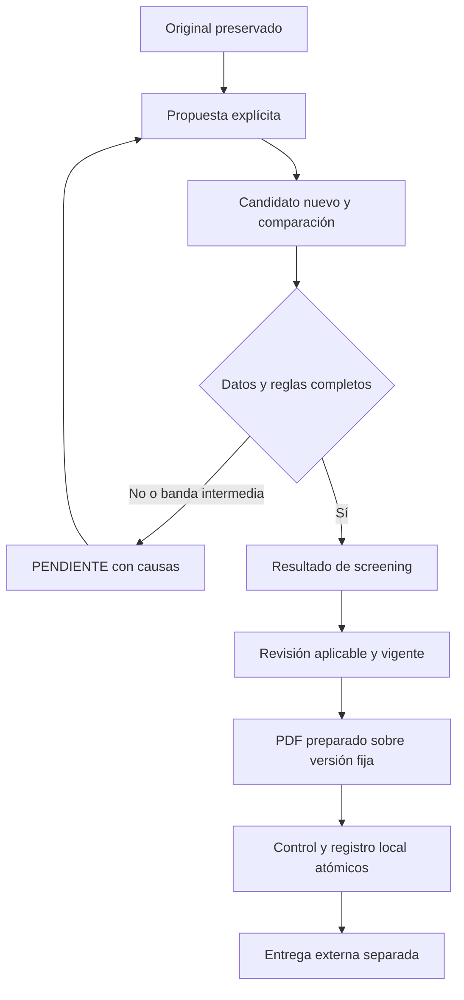

# Ciclo de propuestas revisión y vigencia

El modelo conservará el caso original y cada propuesta como versiones separadas. Proponer un cambio, comprobar su efecto, acreditar una revisión y publicar una decisión son acciones distintas, con evidencia y control de vigencia propios. Este diseño amplía M9 después de T13; todavía no implementa esas acciones operativas.

## Entrada y resultado que se revisan

Lorena aportará una hoja con valores de métricas por deal. Una cifra aportada conserva su fuente y definición; no se presenta como producida por el motor financiero. Los criterios son registros separados con umbral, operador, igualdad, unidad, período, escenario y procedencia explícitos. El contrato final de la hoja completada sigue pendiente: el Input Sheet original de 55 campos no contiene por sí mismo una tabla completa de criterios.

Una propuesta puede cambiar una métrica o una condición expresamente indicada. Debe identificar base, valor anterior, nuevo valor, motivo y evidencia. Si cambia un criterio necesita otra revisión de criterios. T13 vuelve a ejecutar comparaciones; la recalculación completa de M2–M8 necesita los productores financieros pendientes. El registro técnico de una propuesta no demuestra que el cambio esté justificado financieramente.

Los faltantes y conflictos requeridos mantienen PENDIENTE. Las bandas intermedias también mantienen PENDIENTE para revisión profesional, conforme a la decisión del usuario en T12. Ninguna aprobación reemplaza un dato o una regla ausente. Una revisión puede aportar evidencia para resolver el bloqueo, pero el candidato debe recalcularse y validarse con esa evidencia nueva. No se buscan automáticamente valores que produzcan PASS.

## Estados independientes

| Dimensión | Estados candidatos | Significado |
|---|---|---|
| Propuesta | registrada, retirada, sustituida | Describe el ciclo de la propuesta, sin borrar la fuente. |
| Cálculo | no evaluado, bloqueado, reproducido, desactualizado | Reproducido significa que coincide con su evidencia; no equivale a validación financiera independiente. |
| Revisión | no solicitada, solicitada, evidencia no verificada, alcance verificado, rechazada, vencida, revocada | Una revisión con alcance verificado conserva además su decisión y las pruebas de identidad, autoridad y vigencia. |
| Publicación local | no preparada, preparada, confirmada, sustituida | Distingue el archivo preparado del registro transaccional de una decisión actual. |
| Entrega externa | no solicitada, en cola, confirmada, fallida, indeterminada | Una confirmación local no acredita recepción externa. |

Un candidato puede estar reproducido y tener una revisión vencida. Un archivo puede estar preparado y no ser publicable. Una propuesta retirada no revoca por sí misma una revisión ni retira bytes ya entregados. Estas dimensiones evitan que una etiqueta única como “aprobado” oculte esas diferencias.

El diagrama expresa la arquitectura futura. Un resultado de screening no es aprobación de inversión. El avance a Full UW conserva la puerta de PASS vigente y revisión final auténtica aplicable; su workbook sigue diferido al final.

## Registros que se conservarán

El manifiesto del candidato identifica deal, ejecución, inventario de escenarios, fuentes, definiciones, criterios, reglas, dependencias y versión del contexto. Cada candidato conserva padre, diferencia explícita y motivo. Los hashes prueban integridad de bytes; no prueban identidad, autoridad o veracidad financiera.

Los eventos del ciclo conservan identidad de operación, revisión anterior esperada, revisión nueva, actor con su evidencia cuando corresponda, motivo y fecha registrada. Las retiradas y sustituciones agregan eventos; no reescriben el pasado. Un encadenamiento de hashes no protege por sí solo contra un operador que pueda reescribir toda la base: los permisos y controles de almacenamiento siguen siendo necesarios.

La evaluación de revisión vincula el candidato exacto y su alcance con identidad autenticada, autoridad acreditada, decisión, pruebas, política de verificación, intervalo de validez y estado de revocación. No se adopta aquí una matriz de autoridad ni se designa a una persona por su nombre. Un actor declarado puede registrar una propuesta sintética; eso no le permite acreditar una aprobación.

La solicitud de publicación identifica candidato, revisión esperada del contexto, revisión de las autorizaciones, PDF exacto y control de render. Su recibo local conserva la decisión enlazada y el estado de entrega por separado. La observación de entrega conserva intento, destino y confirmación real o incertidumbre.

Los campos candidatos completos se encuentran en [el contrato estructurado](review-lifecycle-design.json). Son requisitos de diseño, no un esquema de base ya instalado ni un servicio de autenticación disponible.

## Cambios y vigencia

| Cambio | Consecuencia diseñada |
|---|---|
| Nueva fuente o fórmula | Invalidar los descendientes afectados; conservar resultados históricos y volver a ejecutar lo necesario. |
| Nuevo criterio | Recalcular comparaciones y precio dependiente. Conservar caja sólo con independencia demostrable. |
| Nuevo escenario o aplicabilidad | Revisar inventario y completitud; no reutilizar automáticamente una revisión de alcance distinto. |
| Nueva revisión humana | Registrar otra evaluación; no modificar la evidencia de la anterior ni ampliar su alcance tácitamente. |
| Vencimiento o revocación | Bloquear su uso posterior. Si la decisión actual dependía de esa revisión, dejar de presentarla como vigente; conservar su historia y registrar el cambio. |
| Retirada de propuesta | Impedir su selección futura por esa vía; conservar lo ya calculado o entregado y tratar sus efectos por registros separados. |

La comparación debe comprobar una revisión monotónica del contexto además de hashes. Si A cambia a B y después vuelve a los bytes de A, la revisión es nueva: un ticket antiguo no recupera vigencia por coincidencia del contenido. Tampoco se mezclan resultados “últimos” tomados de ejecuciones distintas.

## Confirmación local y concurrencia

El PDF se prepara sobre un manifiesto inmutable sin exponerlo como decisión actual. Antes de confirmar se debe comprobar completitud, ausencia de banda bloqueante, revisión aplicable vigente, render correcto y autorización operativa. El PDF externo por deal sigue siendo exactamente una página legible.

La actualización del puntero de decisión actual, su recibo y el control de revisión deben compartir una transacción. La solicitud compara la revisión esperada del contexto: si otra operación la cambió, se rechaza la promoción y el artefacto queda histórico. Ante dos candidatos concurrentes, sólo uno puede confirmar sobre la misma revisión esperada.

Cada operación usa una identidad y un hash de solicitud. Repetir ambos exactamente devuelve el mismo recibo. Reutilizar la identidad con contenido diferente produce conflicto. Un fallo antes del commit revierte decisión y recibo; un reintento después de una respuesta perdida consulta el recibo existente.

La vigencia de identidad y revocación debe participar en una frontera consistente. Si pertenece a un sistema externo, comprobarla antes y escribir después no elimina la carrera. Hará falta una garantía de versión o permiso cercado que el destino compruebe al confirmar, o mantener bloqueada la operación cuando no pueda asegurarse. No se fija un plazo arbitrario de caché o gracia como sustituto de esa garantía.

## Entrega externa y recuperación

Una cola transaccional puede conservar la intención de entrega junto con el recibo local, pero no convierte dos sistemas en una transacción única. Confirmación local, entrega y vigencia actual son hechos diferentes. No se afirma entrega exactamente una vez sin soporte verificable de deduplicación en destino.

Si cambia la revisión o se revoca la autorización mientras el envío está en cola, el destino debe respetar una versión cercada para promover el enlace vigente. Sin esa capacidad, la entrega puede conservarse como artefacto histórico, pero no acreditarse como publicación actual atómica. Ningún envío está autorizado ni se ejecuta en esta fase.

Los artefactos versionados se conservan inmutables. Una sustitución actualiza la referencia vigente y registra la relación con el anterior; no borra la evidencia. Si ya se enviaron bytes a terceros, una retirada local no permite afirmar que fueron recuperados. Fallos de entrega, confirmación perdida y estado indeterminado permanecen visibles.

La recuperación restaura eventos, fuentes, candidatos y recibos; también debe volver a verificar la vigencia externa. Restaurar un backup no renueva una aprobación vencida ni vuelve actual una decisión histórica. GitHub conserva materiales de diseño y código, no bases runtime ni registros reales de clientes.

## Evidencia y aceptación pendiente

Se especifican 28 casos futuros en [el registro de aceptación de este diseño](review-lifecycle-acceptance-cases.json): versiones obsoletas, A→B→A, faltantes, bandas, identidad sin autoridad, alcance parcial, vencimiento, revocación concurrente, render durante una edición, rollback, reintentos, entrega incierta, candidatos concurrentes y recuperación.

Estos 28 casos no fueron ejecutados contra un producto: no se suman a las 273 pruebas técnicas existentes ni sustituyen los 36 casos originales de aceptación financiera. No hay nuevo componente runtime ni cierre de módulo. El avance concreto es la especificación de contratos y consecuencias observables antes de implementarlos.

La trazabilidad de las 15 reglas de diseño apunta a documento, línea o campo y hash en el contrato estructurado. La arquitectura propuesta desarrolla los requisitos existentes de M9; sus estados y registros no se presentan como reglas financieras aprobadas por el profesional. La matriz histórica de 398 filas e I01 permanecen intactos; este documento es una ampliación posterior.

Las decisiones de integración aún abiertas son el mecanismo de autenticación/autoridad, la frontera consistente de revocación, las garantías del destino y los criterios de revisión financiera y render aplicables. Se puede continuar con el diseño y casos sintéticos sin resolverlas como políticas reales.
